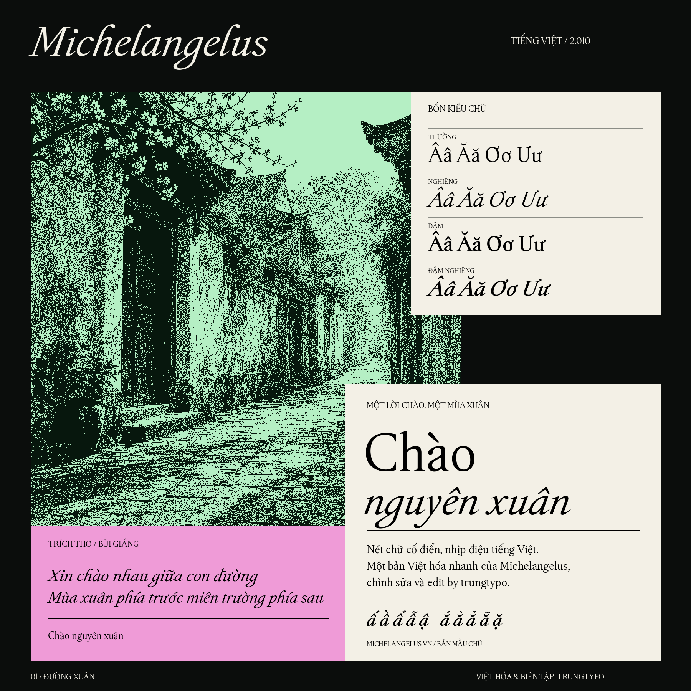
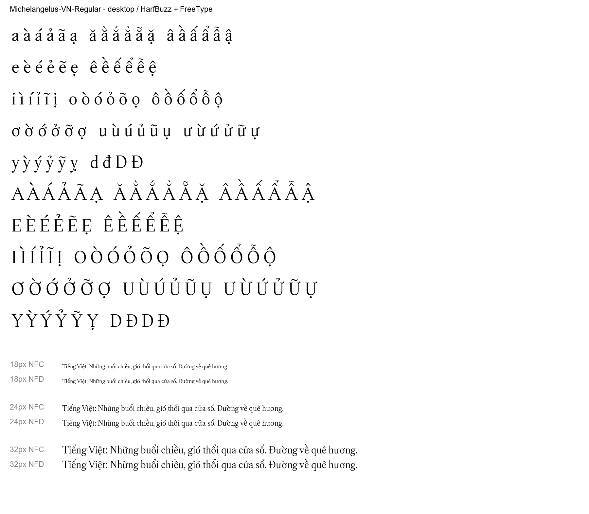

# Michelangelus VN

**Bản Việt hóa chuẩn Typography & Bộ công cụ Cài đặt 1-Click cho font Michelangelus.**  
**Typography-grade Vietnamese adaptation & 1-Click Installer toolkit for Michelangelus.**

*Việt hóa, tinh chỉnh glyph và đóng gói bởi **trungtypo**.*

[Tiếng Việt](#tiếng-việt) · [English](#english)

---



*Poster giới thiệu font chữ Michelangelus VN (trình bày tác phẩm "Chào nguyên xuân" - Bùi Giáng).*

---

## 📁 Cấu trúc thư mục / Repository Structure

```text
Michelangelus-VN/
├── windows/                     # 💻 Dành riêng cho Windows (1-Click)
│   ├── install.bat              # Nhấp đúp để tự động cài font vào Windows
│   ├── install.ps1              # Kịch bản PowerShell cài đặt & ghi Registry
│   ├── uninstall.bat            # Nhấp đúp để gỡ font sạch sẽ khỏi Windows
│   ├── uninstall.ps1            # Kịch bản PowerShell gỡ bỏ font
│   └── README.txt               # Hướng dẫn nhanh cho Windows
│
├── macos/                       # 🍎 Dành riêng cho macOS (1-Click)
│   ├── install.command          # Nhấp đúp để cài font vào ~/Library/Fonts
│   ├── uninstall.command        # Nhấp đúp để gỡ font khỏi macOS
│   └── README.txt               # Hướng dẫn nhanh cho macOS
│
├── assets/                      # 🎨 Poster, bảng chữ & hình nền máy đọc sách
│   ├── Michelangelus-VN-poster-color.png
│   ├── Michelangelus-VN-poster-BW.png
│   ├── preview-Regular.png
│   ├── Chao-nguyen-xuan-X3-BW.png
│   └── Chao-nguyen-xuan-X3-BW.bmp
│
├── vietnamese_builder.py        # 🛠️ Script tự động vá & tạo 4 font tiếng Việt
├── Michelangelus Fonts EULA.rtf  # 📄 Giấy phép bản quyền font gốc Microsoft
├── README.md                    # 📖 Tài liệu hướng dẫn sử dụng
└── SHA256SUMS.txt               # 🔒 Bảng mã băm kiểm tra tính toàn vẹn
```

---

## ⚠️ Thông báo Bản quyền & Pháp lý / Copyright & Legal Disclaimer

> [!WARNING]
> **Bản quyền font gốc thuộc Microsoft Corporation và Fabbrica di San Pietro (Tòa thánh Vatican), thiết kế bởi Studiogusto.**  
> Giấy phép người dùng cuối ([Michelangelus Fonts EULA](Michelangelus%20Fonts%20EULA.rtf)) **nghiêm cấm phân phối lại file font nhị phân (No Redistribution of Font Software)** và **không cho phép thương mại hóa**.

- **Cam kết của repository:** Kho lưu trữ này tuân thủ tuyệt đối bản quyền: **KHÔNG lưu trữ và KHÔNG phân phối trực tiếp bất kỳ file font nhị phân có bản quyền nào (`.ttf`, `.cpfont`)**.
- **Mục đích:** Dự án phi thương mại (non-commercial), phục vụ mục đích nghiên cứu typography, học tập cá nhân và thưởng thức văn học tiếng Việt trên máy tính và máy đọc sách e-ink.
- **Giải pháp Tự làm (DIY Builder):** Chúng tôi cung cấp mã nguồn [`vietnamese_builder.py`](vietnamese_builder.py) để người dùng tự động vá dấu tiếng Việt vào font gốc tải hợp pháp từ Microsoft, cùng các kịch bản 1-click trong thư mục `windows/` và `macos/` để cài đặt nhanh chóng.

---

## Tiếng Việt

Michelangelus VN là dự án bổ sung toàn diện hệ thống dấu tiếng Việt cho font **Michelangelus** — bộ font kỷ niệm Năm Thánh Vatican 2025 mang phong cách Phục Hưng tinh tế do Microsoft Design và Studiogusto phát triển.

### Điểm nổi bật về Typography
- **Đầy đủ 146 ký tự tiếng Việt Unicode**: Bao gồm tất cả các chữ cái có dấu hoa và thường.
- **Dấu 2 tầng hài hòa**: Các tổ hợp phức tạp (`ấ, ầ, ẩ, ẫ, ậ`, `ắ, ằ, ẳ, ẵ, ặ`, `ế, ề, ể, ễ, ệ`, `ố, ồ, ổ, ỗ, ộ`) được căn chỉnh tỉ lệ quang học (optical proportion), đặt vát khéo léo theo dáng nón và trăng, không chạm trần ascender.
- **Râu móc Ơ / Ư cổ điển**: Nét móc uốn cong mềm mại với đầu giọt lệ đặc trưng của trường phái serif Phục Hưng.
- **Sửa lỗi ký tự Đ / đ**: Thay thế lỗi gán dấu caron (`Dcaron / dcaron`) của bản gốc bằng nét gạch ngang thân chuẩn mực.
- **Dấu tham chiếu nguồn mở**: Sử dụng dấu serif từ **EB Garamond** (giấy phép mở SIL Open Font License).



---

### Quy trình Tự Việt hóa & Cài đặt (3 Bước)

```
[1. Tải font gốc Microsoft] ──> [2. Chạy vietnamese_builder.py] ──> [3. Chạy file cài đặt trong windows/ hoặc macos/]
```

#### Bước 1: Tải bộ font gốc chính thức từ Microsoft
1. Tải bộ font gốc miễn phí tại: [Microsoft Download Center (ID 108856)](https://www.microsoft.com/en-us/download/details.aspx?id=108856) hoặc bài viết [Microsoft Design](https://microsoft.design/articles/designing-michelangelus/).
2. Giải nén 4 file font gốc:
   - `Michelangelus-Regular.ttf`
   - `Michelangelus-Bold.ttf`
   - `Michelangelus-Italic.ttf`
   - `Michelangelus-BoldItalic.ttf`
3. Đặt 4 file font trên vào thư mục gốc của repository này (hoặc thư mục con `original/`).

#### Bước 2: Chạy công cụ tự động tạo font Việt hóa
Yêu cầu máy đã cài Python 3. Cài các thư viện xử lý font cần thiết:
```bash
pip install fonttools freetype-py pillow numpy
```
Chạy script tại thư mục gốc:
```bash
python vietnamese_builder.py
```
Script sẽ tự động tải dấu tham chiếu EB Garamond (OFL), tính toán độ dốc, độ dày nét, tạo 94 glyphs tiếng Việt mới và xuất ra 4 file font:
- `Michelangelus-VN-Regular.ttf`
- `Michelangelus-VN-Bold.ttf`
- `Michelangelus-VN-Italic.ttf`
- `Michelangelus-VN-BoldItalic.ttf`

#### Bước 3: Cài đặt 1-Click lên máy tính

| Hệ điều hành | Thư mục | Cách cài đặt | Cách gỡ bỏ |
| :--- | :--- | :--- | :--- |
| **Windows** 💻 | `windows/` | Nhấp đúp chuột vào **`install.bat`** | Nhấp đúp chuột vào **`uninstall.bat`** |
| **macOS** 🍎 | `macos/` | Nhấp đúp chuột vào **`install.command`** | Nhấp đúp chuột vào **`uninstall.command`** |

- **Windows:** Tự động đăng ký cả 4 font vào Windows Registry (hỗ trợ cả User thường lẫn Admin), đồng thời kích hoạt phát tín hiệu cập nhật font cache của Windows để mở Word, Photoshop, trình duyệt... là có font dùng ngay.
- **macOS:** Tự động sao chép font vào thư mục font cá nhân `~/Library/Fonts/`, dùng được ngay trên toàn hệ thống (Pages, Word, Photoshop, Keynote...).

---

### Dành cho Máy đọc sách (E-readers & E-ink)
- **Kindle, Kobo, Boox:** Sau khi tạo xong các file `Michelangelus-VN-*.ttf`, cắm cáp kết nối máy đọc sách với máy tính và chép file font vào thư mục `fonts` trên máy đọc sách.
- **Thiết bị chạy XtOS (xteink firmware):** Sử dụng các công cụ tạo font bitmap hoặc converter để tạo file `.cpfont` từ file TTF đã Việt hóa.
- **Hình nền e-ink nghệ thuật:** Thư mục `assets/` cung cấp sẵn ảnh màn hình khóa e-ink 16 cấp độ xám tối ưu cho máy đọc sách: [`assets/Chao-nguyen-xuan-X3-BW.png`](assets/Chao-nguyen-xuan-X3-BW.png) và [`assets/Chao-nguyen-xuan-X3-BW.bmp`](assets/Chao-nguyen-xuan-X3-BW.bmp).

---

## English

Michelangelus VN is a typography-grade Vietnamese adaptation of the **Michelangelus** typeface, celebrating the Vatican Jubilee 2025, originally designed by Studiogusto and commissioned by Fabbrica di San Pietro & Microsoft Design.

### Typographic Highlights
- **Full Unicode Vietnamese support (146 glyphs)**: Complete coverage of uppercase and lowercase diacritical glyphs.
- **Harmonious stacked diacritics**: Complex accent combinations (`ấ, ầ, ẩ, ẫ, ậ`, `ắ, ằ, ẳ, ẵ, ặ`, `ế, ề, ể, ễ, ệ`, `ố, ồ, ổ, ỗ, ộ`) are optically scaled and angled alongside the circumflex/breve curves without ascender collision.
- **Renaissance horn diacritics (Ơ / Ư)**: Gentle curves with terminal teardrop serifs faithful to the original Italian Renaissance aesthetic.
- **Corrected Đ / đ**: Fixed the upstream font bug where `Đ / đ` had caron diacritics instead of proper typographic crossbars.
- **Open-source reference**: Accent contours adapted from **EB Garamond** (SIL Open Font License).

---

### How to Build & Install (3 Simple Steps)

```
[1. Download Original Font] ──> [2. Run vietnamese_builder.py] ──> [3. Run installer in windows/ or macos/]
```

#### Step 1: Download the official original font from Microsoft
1. Download the original archive from [Microsoft Download Center (ID 108856)](https://www.microsoft.com/en-us/download/details.aspx?id=108856).
2. Extract the 4 original TTF files:
   - `Michelangelus-Regular.ttf`
   - `Michelangelus-Bold.ttf`
   - `Michelangelus-Italic.ttf`
   - `Michelangelus-BoldItalic.ttf`
3. Place them into the root directory of this repository (or an `original/` subfolder).

#### Step 2: Build the Vietnamese fonts
Ensure you have Python 3 installed. Install dependencies:
```bash
pip install fonttools freetype-py pillow numpy
```
Run the builder script in the root directory:
```bash
python vietnamese_builder.py
```
The script will automatically retrieve reference diacritics from EB Garamond (OFL), calculate weights and optical centerlines, assemble all 94 Vietnamese accented glyphs, and export:
- `Michelangelus-VN-Regular.ttf`
- `Michelangelus-VN-Bold.ttf`
- `Michelangelus-VN-Italic.ttf`
- `Michelangelus-VN-BoldItalic.ttf`

#### Step 3: 1-Click Installation

| Operating System | Folder | How to Install | How to Uninstall |
| :--- | :--- | :--- | :--- |
| **Windows** 💻 | `windows/` | Double-click **`install.bat`** | Double-click **`uninstall.bat`** |
| **macOS** 🍎 | `macos/` | Double-click **`install.command`** | Double-click **`uninstall.command`** |

- **Windows:** Automatically copies fonts, writes registry entries (supports both Standard User and Administrator), and broadcasts a system-wide font change message so all apps pick up the font immediately.
- **macOS:** Automatically installs the fonts into `~/Library/Fonts/` for instant access across all applications.

---

### E-Reader & E-ink Usage
- **Kindle, Kobo, Boox, etc.**: Copy the generated `Michelangelus-VN-*.ttf` files directly into your e-reader's `fonts` folder.
- **XtOS (xteink devices)**: Use font conversion tools to generate `.cpfont` files from the built TTF fonts.
- **Included artwork**: High-contrast, 16-level grayscale lockscreen wallpapers are available in `assets/`: [`assets/Chao-nguyen-xuan-X3-BW.png`](assets/Chao-nguyen-xuan-X3-BW.png) and [`assets/Chao-nguyen-xuan-X3-BW.bmp`](assets/Chao-nguyen-xuan-X3-BW.bmp).

---

## Ghi công & Tham chiếu / Credits & Acknowledgments

- **Original Typeface**: **Michelangelus**, designed by **Studiogusto**, commissioned by **Fabbrica di San Pietro**, presented by **Microsoft Design**.
- **Reference Diacritics**: **EB Garamond**, designed by **Georg Duffner** and **Octavio Pardo** (licensed under the [SIL Open Font License](http://scripts.sil.org/OFL)).
- **Vietnamese Adaptation & Builder Tool**: **trungtypo**.
- **Integrity Check**: SHA-256 checksums of repository assets are recorded in [SHA256SUMS.txt](SHA256SUMS.txt).
